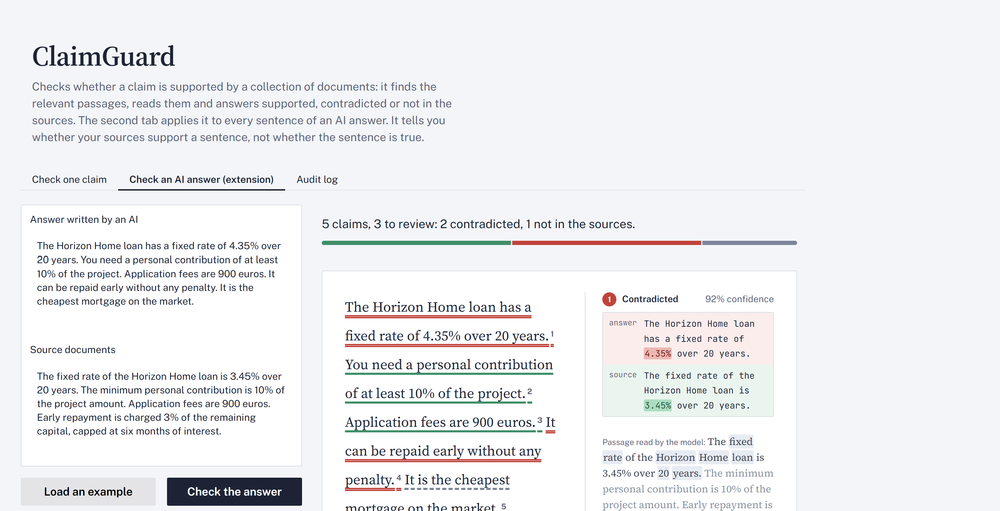

# ClaimGuard

Evidence-based claim verification with calibrated abstention.
NLP final project — topic 2, *Fact Verification with Evidence Retrieval*.

  

## Overview

Language models write fluent text that is sometimes wrong, and a reader cannot tell
which sentences are backed by the sources. ClaimGuard takes a claim (or a whole
answer written by an LLM), searches for evidence in a set of documents, and says for
each claim if it is **SUPPORTED**, **REFUTED** or if there is **not enough
information (NEI)**, with the evidence passage and a confidence score.

The system is a pipeline of five steps that are evaluated one by one: first-stage
retrieval (BM25, dense, or a hybrid of both with Reciprocal Rank Fusion), reranking
with a cross-encoder, verification with a fine-tuned DeBERTa-v3 model, aggregation of
the verdicts of several documents, and calibration of the confidence. With a
calibrated confidence the system can abstain: under a threshold it answers
**UNCERTAIN** instead of guessing.

The project goes further than the benchmark in three directions. (1) Calibration and
abstention are treated as first-class results, with one metric that anyone can read:
out of 10 alerts, how many are real problems. (2) The verifier is stress-tested on
what hurts most in practice: edited numbers, negations and opposite words (a contrast
set), a French banking test set, and an out-of-domain test (Climate-FEVER). (3) It is
deployable: a Gradio demo, a Docker image, an INT8 version, and an MCP server so that
Claude can call the verifier as a tool, with an audit log of every verdict.

One limit to keep in mind: ClaimGuard measures **faithfulness to the documents**, not
truth in the real world. If a document is wrong, a claim that repeats it is
"SUPPORTED". No commercial API is used anywhere; pre-trained open models are only
starting points.

## Installation

Requirements: Python 3.10+ (3.8/3.9 are not supported because of the type hints), and
a CUDA GPU for training (a free Kaggle or Colab T4 is enough). Everything else also runs on CPU.

```bash
git clone <this repo> && cd claimguard
python -m venv .venv && source .venv/bin/activate
make install          # pip install -r requirements-dev.txt && pip install -e .
make test             # 63 unit tests, no download needed
```

Quick try without downloading any model (BM25 + rule-based verifier on a toy corpus):

```bash
make demo-offline     # http://localhost:7860
```

## Dataset

| Dataset | Source | Use | Size |
| --- | --- | --- | --- |
| SciFact | Wadden et al., 2020 (AllenAI release) | main benchmark, retrieval + verification | 5,183 abstracts; 809 train and 300 dev claims with labels |
| Climate-FEVER | Diggelmann et al., 2020 (authors' GitHub) | out-of-domain test of the verifier | 1,535 claims with 5 evidence sentences each (654 SUPPORTS, 474 NEI, 253 REFUTES, 154 DISPUTED) |
| Contrast set | built by `data/scripts/build_contrast_set.py` | robustness to number / negation / antonym edits | generated from the SUPPORTED test claims |
| French bank set | `data/french_bank/` (made for this project) | French + numeric stress test | 60 claims, 20 per label, on 20 invented documents |
| LLM-AggreFact | Tang et al., 2024 (`lytang/LLM-AggreFact` on the Hugging Face hub) | extension: sentences written by LLMs, checked against their source document | test split, 100 claims per sub-dataset |

```bash
make data    # download.py -> preprocess.py -> build_contrast_set.py
```

**Download.** `download.py` gets SciFact from the official AllenAI bucket; if the bucket
is not reachable it uses a GitHub copy. In both cases every file is checked against the
SHA-256 of the official release, so the data is always exactly the same.

**Preprocessing.** The official SciFact test set has no public labels. So the official
dev set (300 claims) is my **test** set, and the official train set is split 85/15
into train and dev, stratified on the label, with a fixed seed. A claim is SUPPORTED
or REFUTED if it has gold evidence with that label, and NEI if it has none. Abstracts
are already split into sentences in the release. `preprocess.py` writes
`data/processed/scifact/stats.json` with the number of claims per label and split.

| Split | Claims | SUPPORTED | REFUTED | NEI | Note |
| --- | --- | --- | --- | --- | --- |
| train | 687 | 282 | 147 | 258 | 85% of the official train set |
| dev | 122 | 50 | 26 | 46 | 15% of the official train set, stratified, seed 13 |
| test | 300 | 124 | 64 | 112 | = official dev set |

Corpus: 5,183 abstracts, 8.9 sentences per abstract on average. Claims are about 13
words long; a claim with evidence has 1.1 evidence abstracts on average.

The French set is described in `data/french_bank/README.md`. The toy corpus in
`data/sample/` (12 short documents, 24 claims) only exists for the tests and the
offline demo; no result in the report comes from it.

## Model Architecture

```
claim ──► BM25 ──────┐
      └─► dense ─────┴─► RRF fusion ─► top-50 ─► cross-encoder ─► top-k documents
                                                                      │ 3 best sentences each
                                                                      ▼
            verdict + confidence ◄─ threshold ◄─ temperature ◄─ aggregation ◄─ verifier (NLI)
```

| Step | Model / method | File |
| --- | --- | --- |
| Lexical retrieval | BM25 Okapi with an inverted index, written from scratch | `src/claimguard/retrieval/bm25.py` |
| Dense retrieval | `BAAI/bge-small-en-v1.5`, CLS pooling, exact cosine search | `retrieval/dense.py` |
| Hybrid | Reciprocal Rank Fusion (k = 60) | `retrieval/hybrid.py` |
| Reranking + sentence selection | `cross-encoder/ms-marco-MiniLM-L-6-v2` | `retrieval/rerank.py` |
| Verifier | DeBERTa-v3-base (184M parameters), from `MoritzLaurer/DeBERTa-v3-base-mnli-fever-anli`, fine-tuned on SciFact | `verify/nli.py`, `verify/train.py` |
| Aggregation | majority / max-confidence / noisy-OR (default) | `aggregate.py` |
| Calibration | temperature scaling + abstention threshold | `calibrate.py` |

The verifier reads (evidence, claim) as an NLI pair: entailment → SUPPORTED,
contradiction → REFUTED, neutral → NEI. Training pairs come from the gold rationale
sentences, from the cited abstracts of NEI claims, and from hard negatives (a document
retrieved by BM25 that is not gold evidence, labelled NEI).

**Hyperparameter tuning.** Grid search on the dev set: learning rate {1e-5, 2e-5,
5e-5} × epochs {3, 5} at batch size 16, one seed per combination (6 runs of about
3 minutes on a Kaggle T4, results in `results/sweep.json`). Batch size 32 was in the
plan but ran out of GPU memory, see `DECISIONS.md`.

| Learning rate | 3 epochs | 5 epochs |
| --- | --- | --- |
| 1e-5 | 0.824 | 0.842 |
| 2e-5 | 0.829 | 0.855 |
| 5e-5 | **0.858** | 0.855 |

(dev macro-F1, gold evidence.) The spread is small: the best setting (5e-5, 3 epochs)
beats the default (2e-5, 5 epochs) by 0.003, which is less than the seed-to-seed
variation (±0.010 on test). I kept the default for the 3 seeds, so the reported numbers
do not depend on a lucky grid point.

The pipeline settings are also chosen on dev only (`results/calibration.json`): k = 3
documents, noisy-OR aggregation, temperature T = 2.42 fitted on claim-level NLL,
abstention threshold 0.5. The test set is used once, for the tables below.

## Training

```bash
python scripts/train_verifier.py --config configs/train_verifier.yaml              # one seed
python scripts/train_verifier.py --config configs/train_verifier.yaml --all-seeds  # 3 seeds
python scripts/train_verifier.py --config configs/train_verifier.yaml --sweep      # grid search
```

The training loop is in `src/claimguard/verify/train.py` (AdamW, linear warmup and
decay, gradient clipping, best epoch kept on dev macro-F1). The checkpoint goes to
`models/verifier/` with a `train_log.json`. `notebooks/03_kaggle_run_all.ipynb` runs
every GPU experiment in one unattended Kaggle run (about 3 h on a T4; a failed step is
logged in `results/run_status.json` and the run goes on). `notebooks/01_colab_run_all.ipynb`
does the same on Colab in 3 interactive sessions.

## Evaluation

```bash
make eval      # retrieval, baselines, calibration, pipeline + ablations, error export
make extras    # contrast set, French set, Climate-FEVER, efficiency
python scripts/evaluate.py aggrefact --per-dataset 100   # extension: LLM answers
make tables    # results/tables.md + results/figures/
```

| Part | Metrics |
| --- | --- |
| Retrieval (evaluated alone) | recall@k, precision@k, MRR, paired permutation test |
| Verification / end-to-end | accuracy, macro-F1, per-class P/R/F1, confusion matrix, FEVER-style score (right label **and** gold evidence retrieved), evidence-sentence F1 |
| Calibration | ECE, reliability diagram, risk-coverage curve (AURC), alert precision / recall at each threshold |
| Efficiency | model size, p50 / p95 latency, seconds per 1,000 claims, FP32 vs INT8 |
| LLM answers (LLM-AggreFact) | balanced accuracy per sub-dataset and mean, as in the benchmark |
| Statistics | 3 seeds, bootstrap 95% CI, McNemar test |

Baselines: majority class, claim-only TF-IDF + logistic regression, rule-based
lexical verifier, BM25 + zero-shot NLI, open-source LLM as a zero-shot judge.
Ablations A1–A6 are listed in `PLAN.md`.

### Results

Unless said otherwise, numbers are on the SciFact test split I made (300 claims,
never used for any choice), and brackets are 95% bootstrap confidence intervals.
"± 0.010" is the standard deviation over the 3 training seeds. The stress tests at the
end use their own test sets. Full tables: `results/tables.md`, figures:
`results/figures/`.

**Retrieval** (188 claims with gold evidence)

| Retriever | Recall@5 | MRR |
| --- | --- | --- |
| BM25 (mine) | 0.859 | 0.798 |
| Dense BGE-small | 0.898 | 0.834 |
| Hybrid (RRF) | 0.912 | 0.836 |
| Dense + cross-encoder | **0.935** | **0.856** |

Dense + reranker vs BM25: +0.076 recall@5, paired permutation test p = 0.0007.

**End-to-end verification**

| System | Macro-F1 [95% CI] | Time per claim |
| --- | --- | --- |
| Majority class | 0.195 [0.176, 0.212] | - |
| Claim only (TF-IDF + LR, no evidence) | 0.401 [0.345, 0.457] | - |
| Rule-based verifier (numbers, negation, overlap) | 0.475 [0.422, 0.533] | - |
| BM25 + zero-shot DeBERTa NLI | 0.570 [0.515, 0.625] | - |
| Full retrieval + zero-shot DeBERTa NLI | 0.609 [0.550, 0.667] | - |
| Full retrieval + LLM judge (Qwen2.5-7B-Instruct, 4-bit) | 0.671 [0.612, 0.722] | 15.4 s (T4) |
| **ClaimGuard** (fine-tuned DeBERTa-v3-base, 3 seeds) | **0.693 ± 0.010** | 0.6 s (T4), 1.0 s (CPU) |
| ClaimGuard with gold evidence (oracle) | 0.743 [0.691, 0.790] | - |

The main system used everywhere else (seed 13, with the temperature T = 2.42 chosen on
dev) gets 0.676 macro-F1; the same seed without temperature gets 0.685. The gap comes
from the temperature, which changes how noisy-OR combines the passages, not from
abstention: macro-F1 is always computed on the model's best guess, and UNCERTAIN
answers are evaluated separately (coverage and selective accuracy, below).

**Key findings**

1. *A fine-tuned 184M encoder does as well as a 7B LLM judge* (0.693 vs 0.671
   macro-F1; the confidence intervals overlap and the difference was not tested). On
   the same T4, ClaimGuard takes 0.6 s per claim versus 15.4 s for the LLM judge, about
   26× faster. ClaimGuard also runs on CPU at 1.0 s per claim, with no API.
2. *Aggregation matters more than retrieval tricks.* The "majority" baseline, which
   averages the probabilities of the passages, collapses to 0.369 macro-F1: several
   neutral passages outweigh the one passage that supports or refutes. Noisy-OR and
   max-confidence let one decisive passage count and get 0.676 / 0.681 (noisy-OR vs
   majority, McNemar p < 0.0001). The reranker
   improves retrieval but changes nothing end to end (p = 1.0).
3. *Most errors are not retrieval failures.* Giving the verifier the gold evidence
   fixes 24 of the 95 errors but creates 5 new ones, a net drop of 19 errors
   (macro-F1 0.676 → 0.743, McNemar p = 0.0005). In the manual annotation, the right
   document is missing for only 9 of the 95 SciFact errors. Both point the same way:
   most errors come from the verifier and from sentence selection (see error analysis).
4. *Calibration.* Temperature scaling (T = 2.42) reduces the expected calibration error
   by 46% (0.260 → 0.141). At threshold 0.8, an alert (REFUTED or NEI) is right 90.5% of the
   time, for 70% coverage.

**Stress tests** (verifier given the evidence, no retrieval)

| Test set | n | Fine-tuned | Zero-shot DeBERTa | Rules |
| --- | --- | --- | --- | --- |
| Climate-FEVER (other domain), macro-F1 | 1,381 | **0.522** | 0.405 | 0.386 |
| My contrast set, consistency | 125 | **0.728** | 0.424 | 0.248 |
| My French banking set, macro-F1 | 60 | **0.949** | 0.934 (multilingual) | 0.765 |
| LLM-AggreFact (LLM answers), balanced acc. | 1,100 | 0.709 | **0.721** | 0.634 |

On the contrast set, the model catches 97% of the negations and 88% of the antonyms
but only **30% of the changed numbers**: it reads "4.35%" and "3.45%" as almost the
same sentence. This is the main weakness I found, and the reason the demo highlights
numbers. On LLM-AggreFact the fine-tuned model is no better than the zero-shot one:
fine-tuning on scientific abstracts does not transfer to summaries of news and
dialogues.

**Efficiency.** 184M parameters, 738 MB in FP32. Dynamic INT8 quantization shrinks it
to 481 MB but accuracy falls from 0.856 to 0.407 (0.455 with only the feed-forward
layers quantized), so I did not keep it (details in `DECISIONS.md`).

### Error analysis

I annotated the 95 SciFact test errors of the main system plus 15 Climate-FEVER
errors, with the help of an AI assistant (`results/Annotation_erreurs_annoté_110.xlsx`,
table in `results/errors_table.md`). A second, blind pass on 25 errors gives the
agreement (Cohen's kappa) between the two passes.

| Category | Errors | Share |
| --- | --- | --- |
| Wrong sentences selected (right document, wrong sentences) | 32 | 29% |
| Related but insufficient (topic matches, an essential part of the claim is not shown) | 19 | 17% |
| REFUTED vs NEI confusion | 15 | 14% |
| Domain vocabulary | 15 | 14% |
| Evidence not retrieved | 9 | 8% |
| Numbers / negation and quantifiers / multi-sentence evidence | 5 each | 14% |
| Gold label questionable | 5 | 5% |

The two biggest groups point to the same thing: the model decides from the topic of
the passage, not from the part of the claim that needs proof. The errors are confident:
44 of the 110 have a confidence of at least 0.8 (mean 0.728 over the 110, 0.746 over the
95 SciFact errors), so a confidence threshold alone does not catch them.

## Demo

```bash
make demo            # full pipeline, http://localhost:7860
make demo-offline    # no model download
```



The page works like a proofreader's copy. Each claim of the answer is underlined with
a line style per verdict (solid supported, double contradicted, dashed not in the
sources, dotted unsure), so the meaning does not depend on colour alone. The margin
holds one note per claim: verdict, confidence and the source sentence it is based on.
For a contradicted claim the note is a small diff between the answer and the source,
with only the words that differ marked (`4.35%` vs `3.45%`).

- **Check an answer** splits an LLM answer into claims and annotates each one.
- **Check one claim** checks one sentence against the indexed SciFact abstracts or
  your own documents (pasted or .txt), with the three probabilities and the passages
  read by the model.
- **Audit log** shows the last verdicts with their model version, downloadable.

Every result shows the inference time and the model size.
Invalid inputs (empty text, text without words, too long, wrong file type) give a
clear message instead of an error.

### MCP server (use ClaimGuard inside Claude)

```bash
make mcp     # python -m claimguard.mcp_server  (stdio)
```

Claude Code: `claude mcp add claimguard -- python -m claimguard.mcp_server`

Claude Desktop (`claude_desktop_config.json`):

```json
{
  "mcpServers": {
    "claimguard": {
      "command": "/absolute/path/to/python",
      "args": ["-m", "claimguard.mcp_server"],
      "env": {"CLAIMGUARD_HOME": "/absolute/path/to/claimguard"}
    }
  }
}
```

Tools: `verify_claim`, `verify_answer`, `verify_citations`, `get_audit_log`.
An MCP tool only runs when the assistant decides to call it, so "check every answer"
needs an instruction in the system prompt (or a hook, see Future Work).

## Docker

```bash
docker build -t claimguard .
docker run -p 7860:7860 claimguard
# with my trained verifier and the SciFact index:
docker run -p 7860:7860 -v $(pwd)/models:/app/models -v $(pwd)/data/processed:/app/data/processed claimguard
```

The image is CPU-only. Models are downloaded at the first start; if that fails the
app falls back to the offline baseline, so the container always starts.

## Project Structure

```
claimguard/
├── data/
│   ├── raw/                 # downloaded files (not committed)
│   ├── processed/           # splits, stats, contrast set (not committed)
│   ├── scripts/             # download.py, preprocess.py, build_contrast_set.py
│   ├── sample/              # toy corpus for tests and offline demo
│   └── french_bank/         # French banking test set + data card
├── models/                  # checkpoints + calibration.json (not committed)
├── src/claimguard/
│   ├── retrieval/           # bm25.py, dense.py, hybrid.py, rerank.py
│   ├── verify/              # nli.py, train.py, lexical.py, llm_judge.py
│   ├── aggregate.py  calibrate.py  metrics.py  stats.py
│   ├── pipeline.py  decompose.py  contrast.py  audit.py  efficiency.py  aggrefact.py
│   ├── mcp_server.py  data.py  text.py  utils.py
├── scripts/                 # train_verifier.py, evaluate.py, make_tables.py, make_figures.py
├── notebooks/               # 03_kaggle_run_all.ipynb, 01_colab_run_all.ipynb, 02_error_analysis.ipynb
├── configs/                 # default.yaml, offline.yaml, train_verifier.yaml
├── tests/                   # 63 tests: preprocessing, retrieval, metrics, model, pipeline
├── app.py                   # Gradio demo
├── Dockerfile  Makefile  requirements.txt  pyproject.toml
├── README.md  PLAN.md  DECISIONS.md
└── report/                  # report draft -> report.pdf
```

## Future Work

- A learned aggregator over the evidence representations (cut here: too little data
  to train it without overfitting).
- Claim decomposition with a small LLM, with pronoun resolution.
- Multi-hop claims that need two documents together (HoVer).
- Long documents with tables (the current chunking is by sentences only).
- A Claude Code hook that calls the verifier after every answer.
- Calibration per claim type (a 0.9 on an amount is not the same as on a description).
- The full LLM-AggreFact benchmark (only a subsample fits in the Colab budget), and a
  direct comparison with MiniCheck on the same subsample.

## References

1. Wadden et al. (2020). *Fact or Fiction: Verifying Scientific Claims.* EMNLP.
2. Thorne et al. (2018). *FEVER: a Large-scale Dataset for Fact Extraction and VERification.* NAACL.
3. Diggelmann et al. (2020). *CLIMATE-FEVER: A Dataset for Verification of Real-World Climate Claims.* arXiv:2012.00614.
4. Robertson & Zaragoza (2009). *The Probabilistic Relevance Framework: BM25 and Beyond.* FnTIR.
5. Karpukhin et al. (2020). *Dense Passage Retrieval for Open-Domain Question Answering.* EMNLP.
6. Xiao et al. (2023). *C-Pack: Packaged Resources To Advance General Chinese Embedding.* arXiv:2309.07597 (BGE models).
7. Cormack, Clarke & Büttcher (2009). *Reciprocal Rank Fusion Outperforms Condorcet and Individual Rank Learning Methods.* SIGIR.
8. Nogueira & Cho (2019). *Passage Re-ranking with BERT.* arXiv:1901.04085.
9. He, Gao & Chen (2023). *DeBERTaV3: Improving DeBERTa using ELECTRA-Style Pre-Training with Gradient-Disentangled Embedding Sharing.* ICLR.
10. Wadden et al. (2022). *MultiVerS: Improving Scientific Claim Verification with Weak Supervision and Full-Document Context.* Findings of NAACL.
11. Guo et al. (2017). *On Calibration of Modern Neural Networks.* ICML.
12. Geifman & El-Yaniv (2017). *Selective Classification for Deep Neural Networks.* NeurIPS.
13. Gardner et al. (2020). *Evaluating Models' Local Decision Boundaries via Contrast Sets.* Findings of EMNLP.
14. Schuster et al. (2019). *Towards Debiasing Fact Verification Models.* EMNLP.
15. Min et al. (2023). *FActScore: Fine-grained Atomic Evaluation of Factual Precision in Long Form Text Generation.* EMNLP.
16. Tang, Laban & Durrett (2024). *MiniCheck: Efficient Fact-Checking of LLMs on Grounding Documents.* EMNLP.
17. Laban et al. (2022). *SummaC: Re-Visiting NLI-based Models for Inconsistency Detection in Summarization.* TACL.
18. Laurer et al. (2024). *Less Annotating, More Classifying.* Political Analysis (the NLI checkpoint).

Tools: PyTorch, Hugging Face Transformers, scikit-learn, Gradio, Model Context
Protocol Python SDK. A coding assistant (Claude Code) was used while writing the
code; design choices are explained in `DECISIONS.md`.
