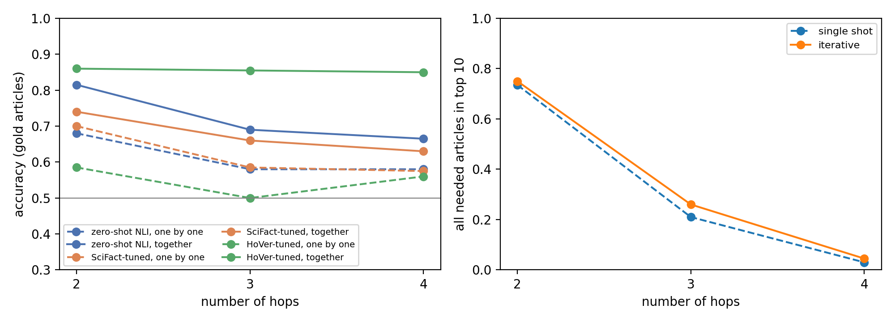
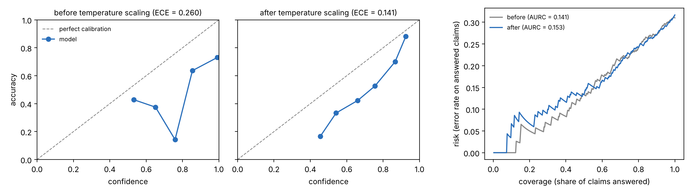
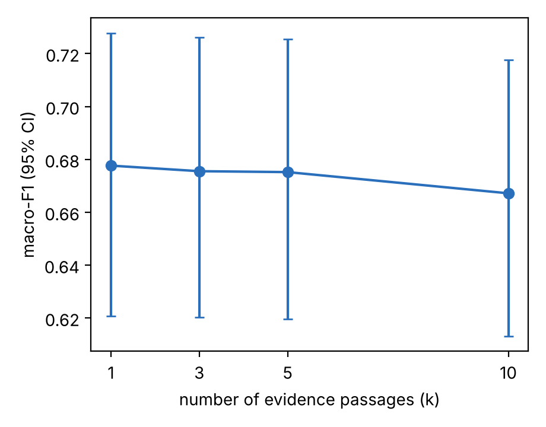
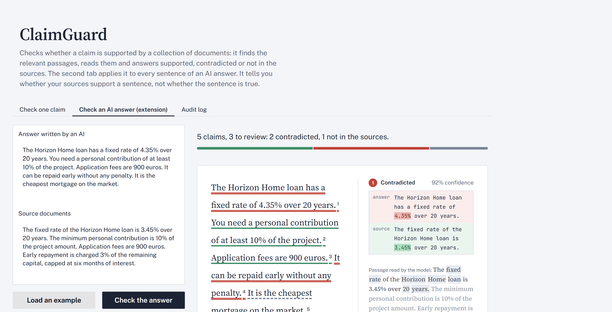
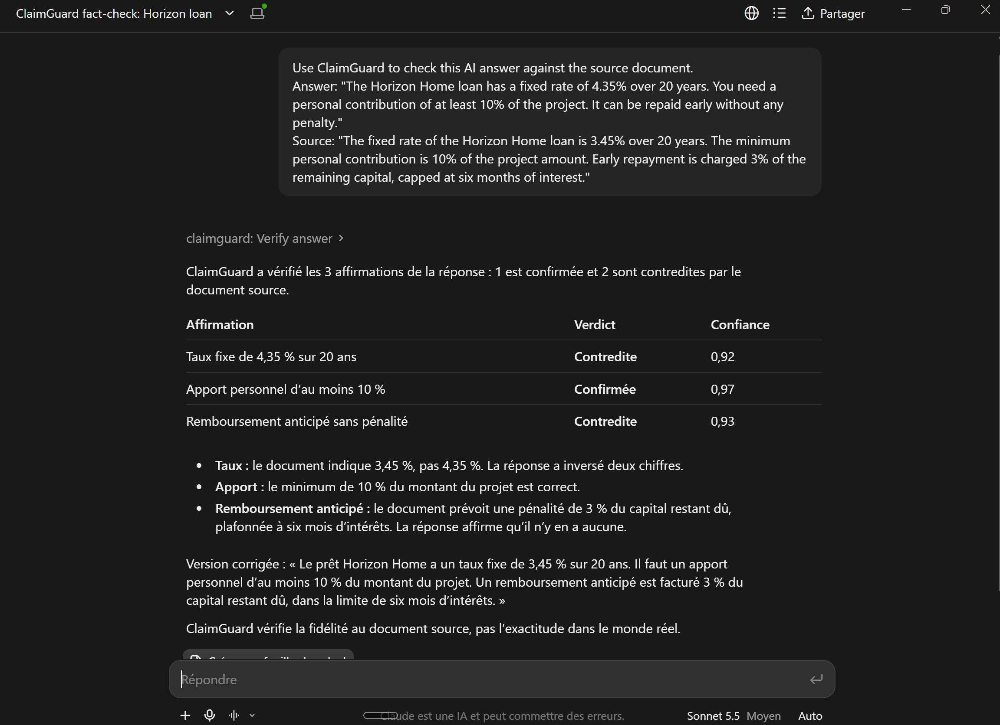
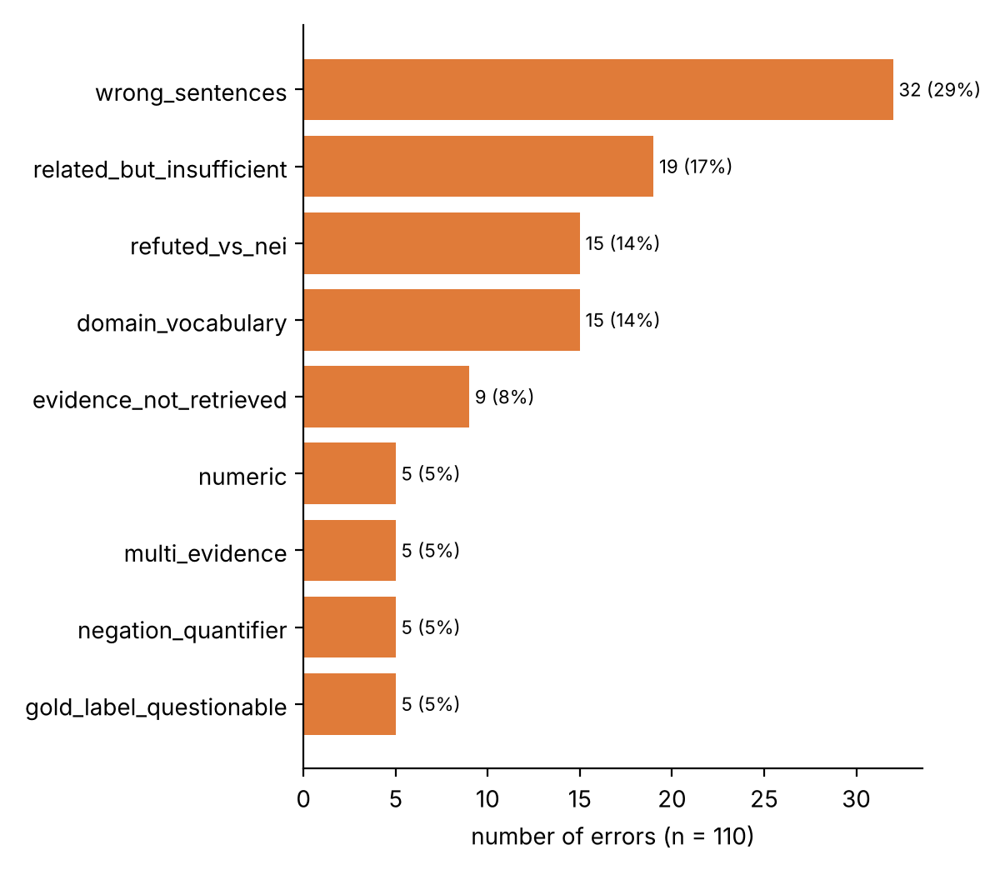

> **Draft status.** Sections 1–5 are written with the real numbers from `results/`.
> Still to do: final read, optional contrast-set hand check in 3.4, PDF export. Remove this box
> before exporting to PDF.

## Abstract

Language models produce fluent answers that are not always supported by their
sources. We present ClaimGuard, a pipeline that checks a claim against a document
collection and returns SUPPORTED, REFUTED or NOT ENOUGH INFO with evidence and a
confidence. It combines hybrid retrieval, cross-encoder reranking, a DeBERTa-v3
verifier fine-tuned on SciFact, noisy-OR aggregation and temperature scaling. On
SciFact it reaches 0.693 ± 0.012 macro-F1 over 3 seeds, significantly above a
zero-shot NLI baseline (0.609) and on par with a 7B LLM judge (0.671, no
significant difference). On claims that have evidence, giving the verifier the gold
abstracts does not help (accuracy 0.739 vs 0.750), but giving it the gold sentences
does (0.851): errors come from picking sentences inside the right abstract.
Temperature scaling cuts the expected calibration error from 0.260 to 0.141. A
contrast set shows that the verifier catches 97% of negation edits but only 30% of
number edits. On multi-hop HoVer claims, a reader trained on HoVer scores 0.86 when
it reads the gold articles together and 0.55 when it reads them one by one; end to
end, reading together raises accuracy from 0.54 to 0.65. ClaimGuard ships with a
demo, a Docker image and an MCP server.

## 1. Introduction

Retrieval-augmented generation is now the standard way to make a language model
answer from a company's own documents. The remaining problem is trust: the answer
reads well whether or not each sentence is backed by the documents, and checking it
by hand removes most of the benefit. Fact verification with evidence retrieval is the
research task behind this problem. Given a claim, a system must find evidence in a
corpus and decide if the evidence supports the claim, refutes it, or is not enough to
decide.

Recent work has shown that small specialised models can check claims against
documents as well as large language models for a fraction of the cost (Tang et al.,
2024). We do not try to show this again. We look at three questions that matter when
such a verifier is actually deployed and that are less often reported together:

1. **Can the confidence be trusted?** A verifier that is wrong with 95% confidence is
   worse than one that says "I am not sure". We calibrate the verifier and measure
   what abstention buys.
2. **Does it catch the errors that hurt?** A changed amount, a removed negation or an
   opposite word leaves almost all the words of a claim unchanged. We build a
   contrast set for these edits and a small French banking test set.
3. **Where do the errors come from?** With retrieval and verification evaluated
   separately, and the verifier re-run on gold abstracts and on gold sentences, we can
   say which stage deserves the next hour of work.

Our contributions are: (i) a complete, tested pipeline in which every stage can be
swapped and measured alone; (ii) an evaluation with five baselines, six ablations,
confidence intervals and significance tests; (iii) a calibration and abstention
study with a metric that non-technical readers understand, the precision of the
alerts; (iv) three stress tests; (v) an evaluation of the same pipeline on sentences written
by LLMs (LLM-AggreFact); (vi) an analysis of 110 errors; (vii) a joint reader and an
iterative retriever for multi-hop claims, tested on HoVer; and (viii) a
deployable tool: demo, Docker image and an MCP server with an audit log.

One limit frames everything that follows: the system measures whether a claim is
supported **by the documents**. It does not know if the documents are right.

## 2. Related Work

**Fact verification datasets.** FEVER (Thorne et al., 2018) defined the task at scale
with 185k claims verified against Wikipedia and a score that requires both the right
label and the right evidence. SciFact (Wadden et al., 2020) moved the task to
scientific claims checked against abstracts, with sentence-level rationales.
Climate-FEVER (Diggelmann et al., 2020) collected real-world climate claims and is
often used as an out-of-domain test. Schuster et al. (2019) showed that FEVER claims
alone, without evidence, already predict the label well above chance, which is why we
include a claim-only baseline.

**Retrieval.** BM25 (Robertson and Zaragoza, 2009) remains a strong lexical baseline.
Dense bi-encoders (Karpukhin et al., 2020) match meaning instead of words, and
general-purpose models such as BGE (Xiao et al., 2023) need no task-specific training. Lexical and dense rankings fail on different queries,
and Reciprocal Rank Fusion (Cormack et al., 2009) combines them using ranks only.
Cross-encoders (Nogueira and Cho, 2019), usually trained on MS MARCO (Nguyen et al.,
2016), read the query and the passage together and are the usual second stage.

**Verification.** Verification is close to natural language inference, and models
pre-trained on NLI data such as MultiNLI (Williams et al., 2018) and ANLI (Nie et al.,
2020) transfer well (Laurer et al., 2024). DeBERTa-v3 (He et al.,
2023) is a strong encoder for this kind of sentence-pair task. On SciFact, MultiVerS
(Wadden et al., 2022) predicts the label and the rationales jointly from the full
abstract and uses weak supervision from other datasets.

**Multi-hop verification.** Some claims can only be checked by combining several
documents. HotpotQA (Yang et al., 2018) introduced multi-hop questions over Wikipedia,
and HoVer (Jiang et al., 2020) turned them into claims that need 2 to 4 articles,
showing that models which match the claim with one passage at a time degrade as the
number of hops grows. Multi-hop dense retrieval (Xiong et al., 2021) retrieves
iteratively, using the passages found in one round to build the next query.

**Checking LLM outputs.** FActScore (Min et al., 2023) splits a generated text into
atomic facts and checks each one. SummaC (Laban et al., 2022) revisited NLI models
for inconsistency detection in summaries. MiniCheck (Tang et al., 2024) trains small
models that match GPT-4-class judges on LLM-AggreFact at a much lower cost. Our verifier
belongs to the same family; we do not claim a better checker.

**Calibration and robustness.** Modern networks are over-confident, and temperature
scaling is a simple and effective fix (Guo et al., 2017). Selective classification
studies the trade-off between coverage and risk when a model may abstain (Geifman and
El-Yaniv, 2017). Contrast sets (Gardner et al., 2020) test a model with small,
meaning-changing edits of test examples.

## 3. Methodology

### 3.1 Task and data

A claim *c* must be labelled SUPPORTED, REFUTED or NEI using a corpus of abstracts.
We use SciFact: 5,183 abstracts and 1,109 labelled claims. The official test labels
are hidden, so the official dev set (300 claims) is our test set and we split the
official train set 85/15 into train and dev, stratified by label. A claim is
SUPPORTED or REFUTED if it has gold evidence with that label, NEI otherwise. This is
a claim-level, three-way setup, so our numbers are not comparable with the official
abstract-level leaderboard.

| Split | Claims | SUPPORTED | REFUTED | NEI | Note |
| --- | --- | --- | --- | --- | --- |
| train | 687 | 282 | 147 | 258 | 85% of the official train set |
| dev | 122 | 50 | 26 | 46 | 15% of the official train set, stratified, seed 13 |
| test | 300 | 124 | 64 | 112 | = official dev set |

Corpus: 5,183 abstracts, 8.9 sentences per abstract on average. Claims are about 13
words long; a claim with evidence has 1.1 evidence abstracts on average.

### 3.2 Pipeline

**First-stage retrieval.** Three interchangeable retrievers over title + abstract:
(a) BM25 with k1 = 1.5 and b = 0.75, implemented with an inverted index; (b) a dense
bi-encoder (BGE-small-en-v1.5, CLS pooling, normalised vectors, exact cosine search);
(c) a hybrid that fuses the two top-50 lists with RRF,
score(d) = Σ 1 / (60 + rank(d)).

**Reranking and sentence selection.** A MiniLM cross-encoder trained on MS MARCO
scores the 50 candidates and keeps the top k, then scores the sentences of each kept
abstract and keeps the best 3 as the evidence given to the verifier.

**Verification.** DeBERTa-v3-base reads (evidence, claim) as an NLI pair and outputs
three logits. We start from a public checkpoint trained on MNLI, FEVER-NLI and ANLI
and fine-tune it on pairs built from SciFact: gold rationale sentences with the claim
label; the selected sentences of cited abstracts for NEI claims; and hard negatives,
one abstract retrieved by BM25 that is not gold evidence, labelled NEI. Training uses AdamW
with 10% warmup and linear decay, and keeps the epoch with the best dev macro-F1.

**Aggregation.** Each of the k documents gives a probability vector. We compare a
soft majority vote (the mean of the k vectors), the single most decisive document, and
a noisy-OR:
P(S) = 1 − Π(1 − pᵢ(S)), P(R) = 1 − Π(1 − pᵢ(R)), P(NEI) = Π pᵢ(NEI), renormalised.

**Calibration and abstention.** Passage logits are divided by a temperature T before
the softmax and the aggregation. T is fitted on dev by minimising the negative
log-likelihood of the *claim-level* probabilities, which is the confidence the user
sees; fitting it on the passage pairs instead made the claim-level ECE worse in our
first CPU runs. The claim-level confidence is the largest aggregated probability. Under a
threshold τ the system answers UNCERTAIN. τ is the smallest value that reaches an
alert precision of 0.9 on dev.

### 3.3 Baselines

We compare with five baselines: (1) majority class. (2) Claim-only: TF-IDF and logistic regression on the claim text,
no evidence. (3) Lexical rules: word overlap, number mismatch and negation mismatch. (4) Minimal system: BM25, no reranker, the NLI checkpoint without fine-tuning. (5) LLM judge: an open-source instruction model (Qwen2.5-7B, Qwen Team, 2024; 4-bit) reads the same
evidence and answers with one letter; we read the logits of the three letters.

### 3.4 Stress tests

**Contrast set.** From each SUPPORTED test claim and its gold evidence we generate
edited claims with one rule: change a number, add or remove a negation, or swap a
direction word for its opposite. We report the share of edited claims that are no
longer predicted SUPPORTED and the consistency (right on the original and reacts to
the edit). This gives 125 edited claims: 20 number edits, 64 negation edits and 41
direction edits.

**French banking set.** 60 claims on 20 invented documents (20 per label); REFUTED
claims change an amount, a rate, a duration, a threshold, a date, a direction or a
negation. We compare the English verifier, a multilingual NLI model and the rules.

**Climate-FEVER.** 1,381 claims (DISPUTED removed), five given evidence sentences
each, verifier and aggregation only, no fine-tuning on this domain.

### 3.5 Checking LLM answers

An answer is split into sentences; questions, greetings and very short sentences are
removed, and each remaining sentence is a claim. The source document is cut into
chunks of 6 sentences; BM25 and the cross-encoder pick the best chunks, then the
verifier and the aggregation run as above. We evaluate on LLM-AggreFact (Tang et al.,
2024), which gathers summaries and RAG answers written by several LLMs, each sentence
labelled supported or not by humans. The task is binary, so SUPPORTED is compared
with REFUTED or NEI, and we report balanced accuracy per sub-dataset and its mean,
the benchmark's own metric. Because of the GPU budget we use 100 claims per
sub-dataset; numbers are therefore not directly comparable with the full leaderboard.

### 3.6 Evaluation protocol

Every value we report is chosen on dev: the number of evidence passages
k ∈ {1, 3, 5, 10}, the aggregation strategy, the abstention threshold and, for the main
system, the temperature (fitted for each setting on the claim-level probabilities).
Baselines and the three training seeds go through the same selection with T = 1. One
design choice was revised after looking at test numbers: an early CPU run of the
rule-based baseline showed that fitting T on passage pairs made the test ECE worse
(0.206 → 0.258), which is why T is now fitted on the claim-level probabilities. The
test set was not used to tune any value after that.
Retrieval is evaluated alone on claims that have evidence: recall@k, precision@k,
MRR. End-to-end we report accuracy, macro-F1, a FEVER-style score (right label and at
least one gold abstract among the evidence), and evidence-sentence F1. Calibration is
measured with ECE (10 bins), the risk-coverage curve and its area (AURC), and alert
precision and recall. The verifier is trained with 3 seeds. Main results have a 95%
bootstrap interval (1,000 resamples). Two systems are compared on the same claims with
McNemar's exact test and a paired bootstrap of the macro-F1 difference (2,000
resamples, `results/paired_tests.json`); retrievers with a paired permutation test on
recall@5. The report contains about 30 tests (SciFact and HoVer) and we give raw
p-values: with this many tests a single p near 0.04 is weak evidence, so the
conclusions we rely on have p < 0.01 or hold across the 3 seeds.

### 3.7 Multi-hop extension

ClaimGuard reads each passage on its own and combines the scores, which cannot work
when no single document proves the claim ("the director of film X was born in Y"
needs the article on X and the article on its director). We add two components and
test them on HoVer (Jiang et al., 2020). (i) A *joint reader*: all the evidence
documents are concatenated into one premise, each document getting the same share of
the 512-token window, and the verifier reads them together. (ii) An *iterative
retriever*: after a first BM25 + cross-encoder round, the title and first sentence of
the two best articles are added to the claim to search again, which can reach the
"bridge" articles that share no words with the claim. HoVer labels are binary, so a
claim counts as SUPPORTED when this is the most probable class. We sample 600 dev claims, 100 for each number of hops (2, 3, 4) and label;
HoVer test labels are not public, so this dev sample is our test set and nothing is
tuned on it. The retrieval pool is built from these dev claims only: the union of
the 100 TF-IDF candidates released with HoVer for each of them and their gold
articles (49,903 articles). We compare three readers: the zero-shot NLI model, our
SciFact verifier, and a joint reader fine-tuned from it on 3,780 HoVer training
claims (2 epochs, 8 minutes on a T4, 3 seeds; 420 other training claims for
validation, scored on the two classes they contain), where NOT_SUPPORTED is mapped to
NOT ENOUGH INFO. As a control, a TF-IDF + logistic regression model trained on all
18,171 training claims guesses the label from the claim alone.

## 4. Experiments

All experiments ran on a free Kaggle T4 GPU (16 GB) in five unattended sessions;
CPU numbers come from the same Kaggle machine. Unless said otherwise, results are on
our SciFact test split (300 claims), brackets are 95% bootstrap intervals, and
"± x" is the standard deviation over the 3 training seeds.

### 4.1 Retrieval (A1, A2)

Table 1 – Retrieval on the 188 test claims that have gold evidence.

| Retriever | R@1 | R@5 | R@20 | MRR |
| --- | --- | --- | --- | --- |
| BM25 (ours) | 0.712 | 0.859 | 0.943 | 0.798 |
| BM25 + rerank | 0.750 | 0.913 | 0.945 | 0.840 |
| Dense (BGE-small) | 0.744 | 0.898 | **0.979** | 0.834 |
| Dense + rerank | **0.760** | **0.935** | 0.975 | **0.856** |
| Hybrid (RRF) | 0.741 | 0.912 | 0.966 | 0.836 |
| Hybrid + rerank | 0.755 | 0.934 | 0.972 | 0.850 |

Our BM25 is already a strong baseline (R@5 = 0.859), which is expected on SciFact
where claims reuse the technical words of the abstract. The dense encoder finds more
of the gold abstracts in the top 20 (0.979), and the cross-encoder turns this into a
better top 5: dense + rerank gains +0.076 R@5 over BM25 (paired permutation test,
p = 0.0007). Hybrid fusion alone is close to dense alone (+0.052 vs +0.039 over BM25),
and once the reranker is applied dense and hybrid reach nearly the same R@5 (0.935 vs
0.934). The reranker adds more than the choice between dense and hybrid.

### 4.2 Hyperparameter search

Table A3 in the appendix gives the dev macro-F1 of the six settings (batch size 16, one seed each).

Batch size 32 was planned but did not fit in the T4 memory in float32. All six runs
are within 0.034 of each other, and the best one (5e-5, 3 epochs) is only 0.003 above
our default (2e-5, 5 epochs), a small difference in a single-seed search. We kept the
default and evaluated it across three seeds.

### 4.3 Main results and baselines

Table 2 – End-to-end results on SciFact test (300 claims); brackets: 95% bootstrap interval.

| System | Accuracy | Macro-F1 | FEVER | Ev. F1 | Time / claim |
| --- | --- | --- | --- | --- | --- |
| Majority class | 0.413 | 0.195 [0.176, 0.212] | – | – | – |
| Claim only (TF-IDF+LR) | 0.437 | 0.401 [0.345, 0.457] | – | – | – |
| Rules | 0.517 | 0.475 [0.422, 0.533] | 0.473 | 0.273 | – |
| BM25 + zero-shot NLI | 0.580 | 0.570 [0.515, 0.625] | 0.543 | 0.253 | 0.05 s |
| Full retr. + zero-shot NLI | 0.617 | 0.609 [0.550, 0.667] | 0.583 | 0.340 | 0.37 s |
| Full retr. + LLM judge (Qwen-7B) | 0.687 | 0.671 [0.612, 0.722] | 0.643 | 0.350 | LLMTIME |
| **ClaimGuard**, 3 seeds (T = 1) | 0.701 ± 0.012 | **0.693 ± 0.012** | 0.672 ± 0.004 | 0.329 ± 0.027 | – |
| ClaimGuard, main (seed 13, T = 2.42) | 0.683 | 0.676 [0.620, 0.726] | 0.663 | 0.308 | 0.40 s (5.9 s CPU) |

FEVER = right label and at least one gold abstract among the evidence (a document-level
version of the FEVER score, since SciFact rationales are sentence sets); Ev. F1 = F1 of
the selected evidence sentences against the gold rationales. Time = median per claim
over 20 test claims, each system with its own k chosen on dev, whole pipeline
(retrieval, reranking, verification) on a T4; CPU = 2 Kaggle threads, no GPU. The three seeds run with
T = 1 and each picks its own k and aggregation on dev (seed 42 picks k = 1); the main
system, used for calibration (Section 4.5), the ablations and the error analysis, is
seed 13 with the temperature fitted on dev.

Per class (main system): SUPPORTED F1 0.742, REFUTED 0.667, NEI 0.618.

The claim-only baseline reaches 0.401 without reading any evidence, twice the majority
class: part of the label can be guessed from the wording alone, as reported for FEVER
(Schuster et al., 2019). Reading evidence with a zero-shot NLI model adds 0.21, and
fine-tuning on SciFact another 0.07 (main system vs zero-shot: +0.067 macro-F1, paired
interval [+0.009, +0.124], McNemar p = 0.04; p ≤ 0.02 for each of the 3 seeds). The
184M-parameter verifier and the 7B LLM judge are on par: +0.005 [−0.055, +0.064],
McNemar b = 41, c = 42, p = 1.0. LLMSPEED The LLM judge and the zero-shot model pick slightly better evidence sentences
(evidence F1 0.350 and 0.340 vs 0.308): fine-tuning improved the verdicts more than the
evidence. NEI is the hardest class (Section 5).

### 4.4 Ablations (A3–A6)

Table 3 – Ablations on the main system (macro-F1 on test).

| Ablation | Setting | Macro-F1 |
| --- | --- | --- |
| A2 reranker | with / without | 0.676 / 0.676 |
| A3 evidence passages k | 1 / 3 / 5 / 10 | 0.678 / 0.676 / 0.675 / 0.667 |
| A4 aggregation | majority / max-confidence / noisy-OR | 0.369 / 0.681 / 0.676 |
| A5 verifier | zero-shot NLI / plain DeBERTa + SciFact / NLI + SciFact (3 seeds) | 0.609 / 0.509 / 0.693 |
| A6 evidence (188 claims with evidence, accuracy) | retrieved / gold abstracts / gold sentences | 0.750 / 0.739 / 0.851 |

**A2.** The reranker improves retrieval (Table 1) and the evidence F1 (0.287 → 0.308)
but not the verdict: verdicts change in both directions and cancel out (McNemar b = 20,
c = 21, p = 1.0).
**A3.** k barely matters between 1 and 5 (Figure A2 in the appendix); k = 10 loses a
little because more neutral passages enter the aggregation. k = 3 was chosen on dev.
**A4.** This is the largest effect of the study, and the lesson is not to average the
passages. Averaging their probabilities scores 0.369, because neutral passages outweigh
the one that supports or refutes. Noisy-OR and max-confidence let a single decisive
passage count and do equally well (0.676 and 0.681; noisy-OR vs average: b = 106,
c = 37, p < 0.0001; noisy-OR vs max: p = 1.0).
**A5.** Starting from an NLI checkpoint is essential: the same architecture
fine-tuned from plain DeBERTa-v3-base gets 0.509, below the zero-shot NLI model.
With 687 training claims, prior NLI training is needed.
**A6.** The 112 NEI claims have no gold evidence, so perfect evidence cannot change
them: we compare on the 188 claims that have some. Giving the verifier the gold
abstracts, with our own choice of 3 sentences, changes nothing (0.739 vs 0.750; 6
errors fixed, 8 created, p = 0.79): retrieval already finds the right abstract. Giving
it the gold sentences fixes 24 of the 47 errors and creates 5 (0.851, p = 0.0005). The
gap is therefore in sentence selection, not in document retrieval, which matches the
largest category of the error analysis (Section 5). The 23 errors left with gold
sentences, and the 48 NEI errors, come from the verifier itself.

### 4.5 Calibration and abstention

The raw model is over-confident: before scaling, ECE is 0.260. Temperature scaling
with T = 2.42 (fitted on dev, at the claim level) reduces it by 46% to 0.141
(Figure A1 in the appendix). But the area under the risk–coverage curve (AURC, lower is
better) rises from 0.142 to 0.153: scaling before noisy-OR changes the ranking of the
claims, so the gain is partial.

Table 4 – Abstention after temperature scaling. An alert is a REFUTED or NEI verdict.

| Threshold | Coverage | Selective accuracy | Alert precision | Alert recall |
| --- | --- | --- | --- | --- |
| 0.0 | 1.000 | 0.683 | 0.841 | 0.750 |
| 0.5 (chosen on dev) | 0.980 | 0.694 | 0.850 | 0.739 |
| 0.7 | 0.823 | 0.753 | 0.876 | 0.642 |
| 0.8 | 0.697 | 0.794 | 0.905 | 0.540 |
| 0.9 | 0.363 | 0.881 | 0.935 | 0.165 |

Macro-F1 in Tables 2–3 is computed on the model's best guess; UNCERTAIN answers only
appear here. The threshold chosen on dev (0.5, the smallest value that reached an alert
precision of 0.9 on dev) does not transfer: on test its alert precision is 0.850 and it
still answers 98% of the claims, so abstention is almost inactive. The rows above 0.5
are read on test and are only indicative: a user who wants alerts that are right 9
times out of 10 can move to 0.8 (0.905, on 105 alerts) and keep 70% coverage, but then
misses about half of the problems (alert recall 0.540; Figure A1, right).

### 4.6 Stress tests

On the contrast set (Table A4), the fine-tuned model is the most consistent: it accepts
the original claim and flags the edit for 72.8% of the pairs, against 42.4% for the
zero-shot model and 24.8% for the rules, which look good on edits only because they
reject most claims anyway. It flags 97% of negation edits and 88% of direction edits
but only **30% of changed numbers** ("a rate of 4.35%" and "of 3.45%" look almost the
same to it), worse than the zero-shot model (70%); SciFact rarely hinges on a single
value. On Climate-FEVER (Table A5), a new domain, the fine-tuned verifier keeps a clear
lead (macro-F1 0.522 vs 0.405 zero-shot and 0.386 rules) and is better calibrated than
the zero-shot model (ECE 0.113 vs 0.434; the rarely confident rules have 0.063). On our
French banking set it gets 57 of 60 right (multilingual NLI model: 56); its 3 errors are
"missing information" claims. We wrote that set ourselves, so it only shows that the
pipeline is usable on French text.

### 4.7 Sentences written by LLMs

Table A1 in the appendix gives the balanced accuracy on each of the 11 sub-datasets (100 claims each).

On average, fine-tuning on SciFact does not help on LLM outputs (mean balanced accuracy 0.709 for the fine-tuned verifier, 0.721 zero-shot, 0.634 rules). The
picture depends on the kind of text: the fine-tuned model is better on the RAG and
long-form QA sets (Lfqa, RAGTruth, Reveal, ClaimVerify), where a sentence is checked
against retrieved passages as in SciFact, and worse on summaries of news and of
dialogues (AggreFact-CNN 0.583 vs 0.739, TofuEval-MediaS 0.638 vs 0.686). With 100 claims per
sub-dataset, small differences should be interpreted cautiously.

### 4.8 Efficiency

On a T4, the whole pipeline takes 0.40 s per claim (median; p95 0.44 s), and 87% of
it is the cross-encoder reranking (0.35 s), not the verifier (0.04 s for 3 passages).
On CPU only (2 Kaggle threads) it takes 5.9 s per claim (p95 6.6 s): 5.1 s of
reranking, 0.67 s of verification. The reranker improves retrieval but not the
verdicts (A2), so it is the first thing to drop or shrink for a CPU deployment; we did
not measure that configuration. The verifier weighs 738 MB for 184M parameters
(Table A2). Dynamic INT8 quantization saves 35% of the size but only 11% of its CPU
time, and accuracy drops sharply even with the attention layers kept in FP32, so we
kept FP32.

### 4.9 Multi-hop claims (HoVer)

Table 5 – HoVer, 600 dev claims (200 per number of hops, balanced labels, chance = 0.5).
Accuracy with the gold articles, read one by one (noisy-OR) or together. 95% intervals:
about ±0.04 on All, ±0.07 per number of hops. HoVer-tuned: mean of 3 seeds (std ≤ 0.01).

| Reader | Reading | All | 2 hops | 3 hops | 4 hops | + 3 distractors |
| --- | --- | --- | --- | --- | --- | --- |
| Zero-shot NLI | one by one | 0.613 | 0.680 | 0.580 | 0.580 | 0.597 |
| Zero-shot NLI | together | 0.723 | 0.815 | 0.690 | 0.665 | 0.640 |
| SciFact-tuned (ours) | one by one | 0.620 | 0.700 | 0.585 | 0.575 | 0.617 |
| SciFact-tuned (ours) | together | 0.677 | 0.740 | 0.660 | 0.630 | 0.620 |
| HoVer-tuned (ours) | one by one | 0.556 | 0.592 | 0.507 | 0.568 | 0.566 |
| HoVer-tuned (ours) | together | **0.857** | **0.865** | **0.862** | **0.843** | **0.744** |
| Claim only (TF-IDF + LR) | – | 0.562 | 0.585 | 0.600 | 0.500 | – |

{width=78%}

**Reading the articles together is what makes multi-hop work.** Joint reading beats
the one-by-one reading of ClaimGuard for the zero-shot model (+0.11, McNemar b = 144,
c = 78, p < 0.001) and for the HoVer-tuned reader (+0.30, p < 0.001 for each seed); for
our SciFact verifier the gain is smaller (+0.06, p = 0.03). Joint reading also shortens
each article (330 words shared between them), so we read the articles one by one with
the same cut: this gives 0.620 / 0.635 / 0.555 for the three readers, almost the same
as uncut one-by-one reading, and joint reading still wins (p < 0.001 for the zero-shot
and HoVer readers, p = 0.11 for the SciFact one). The gain comes from reading together,
not from shorter inputs. Read one by one, accuracy falls from about 0.70 at 2 hops to
0.58 at 3 and 4 hops: when no single article proves the claim, combining per-article
scores cannot recover the link. The HoVer-tuned joint reader stays at 0.84–0.87 for
every number of hops, while the two other readers lose 0.10–0.15: concatenating is not
enough, the reader has to learn to combine. Read one by one, the HoVer-tuned reader is
no better than the claim-only control (0.556 vs 0.562), having learned that one article
is rarely enough. With 3 distractor articles in the premise it drops to 0.744 but stays
far above one-by-one reading.

Table 6 – HoVer end to end, HoVer-tuned reader (seed 13, fixed before the run).

| Retrieval | Reading | Top 5 | Top 10 |
| --- | --- | --- | --- |
| one round | one by one (ClaimGuard) | 0.538 | 0.533 |
| one round | together | 0.632 | 0.600 |
| two rounds (iterative) | one by one | 0.537 | 0.520 |
| two rounds (iterative) | together | **0.648** [0.608, 0.687] | 0.603 |

**Retrieval is the bottleneck.** In a pool of 49,903 articles, all the needed articles
are in the top 10 for 74% of the 2-hop claims, 21% of the 3-hop claims and 3% of the
4-hop claims. The iterative retriever finds them more often (35% against 33% overall,
McNemar b = 24, c = 8, p = 0.007; 26% against 21% at 3 hops) but rarely reaches the
third or fourth article. End to end (Table 6), reading together is the factor that
matters: +0.09 to +0.11 at top 5 (p < 0.001 with one or two rounds), +0.07 to +0.08 at
top 10 (p ≤ 0.02). The second retrieval round adds +0.016 at top 5 and nothing at top
10 (p ≥ 0.11): its retrieval gain is real but too small to show in the verdicts.
Top 10 is worse than top 5 for joint reading, because each article then gets only 33
words. The best setting (0.648) is clearly above the claim-only control (0.562) and
ClaimGuard's reading (0.538, p < 0.001), but far from the 0.857 reached with the gold
articles. The pool is built from the dev claims only, and nothing was tuned on this
sample (HoVer test labels are not public).

## 5. Error Analysis

**Protocol.** We export every wrong prediction of the main system on the SciFact test
set (95 errors) and add the 15 errors of a random sample of Climate-FEVER, which
gives 110 errors. Each error is first tagged automatically: *retrieval miss* (the
claim has gold evidence and none of it reached the verifier) or *verification
error*, presence of a number, presence of a negation. Then each error receives one
category (taxonomy in Table 7), with a short note justifying it. The author annotated
all 110 errors alone, in a spreadsheet, reading for each one the claim, the passages
given to the verifier and the gold rationale.
To check the consistency of the categories, 25 errors drawn at random were annotated a second time by the author, without access to the first labels, the same day a few hours after the first pass. The two passes agree on 24 of the 25 errors (96%), Cohen's κ = 0.95 (`results/kappa.json`). The only change is claim 1280, moved from domain vocabulary to related but insufficient, two categories that overlap when a technical term hides a missing link. The short delay probably inflates the agreement, so this number shows that the categories are usable, not that they are fully reliable.

### 5.1 Quantitative breakdown

Table 7 – Error categories (110 errors).

| Category | Definition | SciFact | Climate | Total | Main confusion |
| --- | --- | --- | --- | --- | --- |
| Wrong sentences | right document, wrong sentences given to the verifier | 25 | 7 | 32 (29%) | SUPPORTED → NEI |
| Related but insufficient | related evidence read as proof of an essential part it does not establish | 17 | 2 | 19 (17%) | NEI → SUPPORTED |
| REFUTED vs NEI | evidence weighs against the claim without contradicting it, or the reverse | 11 | 4 | 15 (14%) | NEI → REFUTED |
| Domain vocabulary | a technical term or relation is misread | 15 | 0 | 15 (14%) | NEI → SUPPORTED |
| Evidence not retrieved | no gold document reached the verifier | 9 | 0 | 9 (8%) | REFUTED → NEI |
| Numbers | number, unit or statistical result misread | 4 | 1 | 5 (5%) | SUPPORTED → NEI |
| Multi-sentence evidence | proof needs two sentences together | 5 | 0 | 5 (5%) | SUPPORTED → NEI |
| Negation / quantifier | scope of "not", "no evidence", "often" | 4 | 1 | 5 (5%) | REFUTED → SUPPORTED |
| Gold label questionable | our reading disagrees with the gold label | 5 | 0 | 5 (5%) | NEI → SUPPORTED |

Figure A5 in the appendix shows the same counts. Three numbers stand out.

* **Errors are made with confidence.** 44 of the 110 errors have a confidence of at
  least 0.8 (mean 0.728 over the 110, 0.746 over the 95 SciFact errors). A threshold
  set at that level would still let these errors through.
* **The most frequent confusion is NEI → SUPPORTED** (39 of 110). On SciFact, NEI
  claims have the highest error rate (48 of 112, 43%), against 34% for REFUTED
  (22 of 64) and 20% for SUPPORTED (25 of 124).
* **Numbers and negations are not where SciFact errors are.** Claims with a number
  have an error rate of 29% (33 of 114) against 33% for the others (62 of 186); claims
  with a negation 24% (7 of 29) against 33%. This looks like it contradicts the
  contrast set, but it does not: the number flag groups project names ("1,000 Genomes project") with genuine prevalence claims ("1/2000 in the UK"). The contrast set isolates a different question: does the verdict change when only the value changes?

### 5.2 Qualitative analysis

(Evidence shortened. Translated from our annotation notes.)

**Wrong sentences.** Claim 128, *"Arterioles have a larger lumen diameter than
venules"* (gold NEI, predicted SUPPORTED, 0.88). The retrieved abstract compares the
aorta with the coronary arteries; venules never appear. The sentences given to the
verifier speak about vessel diameter, so the model accepts the comparison. Claim 3
(gold SUPPORTED, predicted NEI, 0.83) is the reverse case: the claim is supported
by its gold evidence, but the sentences given to the verifier come from a study of
the gene PPM1D and say nothing about the penetrance of the 1,000 Genomes variants. In both cases the error comes from the sentence selection step, which ranks
sentences by similarity to the claim instead of by how much they decide it.

**Related but insufficient.** Claim 36, *"A deficiency of vitamin B12 increases blood
levels of homocysteine"* (gold NEI, predicted SUPPORTED, 0.74). The abstract reports a
diet that lowers homocysteine while vitamin B12 *stays unchanged*: same topic, same
two entities, but nothing about a deficiency. Claim 350 (0.82) is similar: IF3 takes
part in translation initiation, which does not show that it discriminates between the
two tRNAs. The model checks that the claim's entities and relation appear in the
passage, not that the specific link the claim asserts is established.

**REFUTED vs NEI.** Claim 213, *"CRP is not predictive of postoperative mortality
following CABG surgery"* (gold NEI, predicted REFUTED, 0.92). The abstract links CRP
to long-term mortality after bypass surgery; the claim leaves the postoperative time horizon unspecified. An association over long-term follow-up does not by itself settle the prediction question as worded.

**Domain vocabulary.** The pair of claims 268 and 269 is telling: *"Cold exposure
increases BAT recruitment"* is predicted SUPPORTED (0.82) and *"Cold exposure reduces
BAT recruitment"* is predicted REFUTED (0.82), while both are NEI (the second one is
counted under REFUTED vs NEI). The abstract says
that cold makes brown adipose tissue express Ucp1, a thermogenic response, but never
measures recruitment of the tissue. The model treats "express Ucp1" and "recruit BAT"
as interchangeable, although the passage measures only the former.

**Negation scope.** Claim 1290, *"There is an inverse relationship between hip
fractures and statin use"* (gold SUPPORTED, predicted REFUTED, 0.91). The abstract
says the risk falls with statin use and that there is "no evidence of such
relationships with nonstatin lipid-lowering agents". The model attaches "no
evidence" to statins instead of to the other drugs.

### 5.3 What the errors tell us

1. **The verifier judges topic overlap more than support.** Related but insufficient,
   domain vocabulary and most NEI → SUPPORTED errors (39 of 110) share the same
   pattern. *Fix:* add hard negatives built from the gold abstract itself (sentences of
   the right abstract that do not support the claim, labelled NEI) so that the model
   learns that the right topic is not enough.
2. **Wrong sentence selection is the most frequent annotated category** (32 errors), while reranking documents left the end-to-end score unchanged in this experiment. *Fix:* select sentences with the verifier's own scores, or give the
   verifier the whole abstract when it fits in 512 tokens.
3. **Confidence does not separate these errors.** 40% of them are made with at least
   0.8 confidence, so abstention protects against hesitant errors only. *Fix:* report
   the decisive passage to the user, as the demo does, so a human can check it in a
   few seconds.
4. **Numbers are a hidden risk.** They are rare in SciFact errors but the contrast
   set shows that the model misses 70% of changed numbers, which matters most for the
   use cases we target (banking, prices, dates). *Fix:* a rule that compares the
   numbers of the claim and of the decisive sentence before the verifier, as in our
   lexical baseline, which flags 100% of number edits (it also rejects many true
   claims, so it should only send a warning, not decide alone).
5. **Some labels are debatable** (5 of 110). On a test set of 300 claims, a few disputed decisions warrant a closer look when comparing nearby scores in Table 2.

## 6. Discussion

**What worked.** The biggest improvement came from not averaging the passages. Our majority baseline averages the probabilities across passages. Two passages that say very little can outweigh the one that actually answers the question. With noisy-OR or max-confidence, that one passage can still decide the verdict. Macro-F1 went from 0.369 to 0.676 with noisy-OR and 0.681 with max-confidence. Starting from an NLI model helped too. It had already learned to recognise when a passage supports or contradicts a claim. After fine-tuning on SciFact, it scored 0.693, compared with 0.509 when we started from plain DeBERTa.

**What surprised us.** We expected better retrieval to lead to better answers. The reranker did find more of the right abstracts near the top, but the final macro-F1 was 0.676 either way. Even with the right abstract, the model still has to pick the sentence that answers the question. What surprised us most was how often a small edit slipped through. The model missed 14 of the 20 number changes in the contrast set. Change a rate from 4.35% to 3.45% and almost every word stays the same, even though the verdict should change. Confidence alone wouldn't solve the problem either. Across the 110 annotated errors, 44 had a confidence score of at least 0.8.

**Beyond SciFact.** On Climate-FEVER, fine-tuning improved macro-F1 by about 0.12 over the zero-shot model. On our French banking set, the model got 57 of 60 claims right, though we wrote those examples ourselves. The picture was more mixed on LLM-AggreFact. Fine-tuning helped on RAGTruth but hurt on news summaries. Across the benchmark sample, mean balanced accuracy was 0.709 after fine-tuning and 0.721 with the zero-shot model. We'd want to know what kinds of documents a team works with before telling them which model to use.

**What a company would still need.** If we showed this to a bank tomorrow, we'd start with an analyst reviewing a draft. In the demo, the analyst can see the passage behind a verdict. For a flagged rate, we'd want the amount, currency and date highlighted so the analyst could check all three at a glance. We'd also test a product sheet that lists several rates. Does the tool pick the rate for the right product and period? Is it using the latest version of the sheet? Before a rollout, we'd run a pilot on the bank's own documents and measure how many important mistakes the tool catches and how much time analysts spend reviewing its alerts.

**Ethical considerations.** When ClaimGuard says SUPPORTED, it means the documents we gave it back up the claim. If a product sheet lists the wrong rate, a claim that repeats that rate can still get a SUPPORTED verdict. It's easy to read that label as proof that the rate is correct, especially when the score is high. In our review, 44 of the 110 wrong answers had a confidence score of at least 0.8. Someone should always read the original passage before making a decision based on the result.
SciFact uses English biomedical texts, and we wrote the 60 claims in our French banking set ourselves. We'd need more testing before we could expect similar results in other languages or fields. ClaimGuard runs locally without calling any external APIs, but the audit log still saves the claims people enter. A company using it should decide how long to keep those claims and delete them when that time is up.

**Limitations.** (1) Faithfulness, not truth: a claim that repeats a wrong document
is SUPPORTED. (2) The test set has 300 claims, so intervals are wide and small
differences are hard to interpret. (3) SciFact annotations are incomplete, so some hard
negatives used in training and some "false" positives at test time may be real
evidence. (4) English training data only; the French set is small and synthetic. (5) Sentences are checked one by one without resolving pronouns. The joint reader
is a separate module (`claimguard.multihop`) tested on HoVer; the demo and the MCP
server still read passages one by one, which is right for SciFact-like single-document
claims but not for multi-hop ones. Multi-hop retrieval is weak: all the articles of a
4-hop claim are found for 4% of the claims (Section 4.9). (6) The contrast set labels come from rules. (7) The error categories were assigned by a single annotator, the author, and both passes took place on the same day. Their agreement shows that the author applies them consistently, not that someone else would. (8) Long documents with tables are out of scope. (9) Our dev split is random by claim, not by document, and it is easier than the test set (macro-F1 about 0.83 on dev against 0.68 on test), so the values tuned on dev, the threshold above all, are optimistic.

## 7. Conclusion and Future Work

Three things stuck with us from building ClaimGuard. A small model trained on a similar task came close to the 7B judge on SciFact and ran about 25 times faster on the same GPU. Changing a single number showed us a weakness we'd have missed if we'd only looked at the overall score. And the feature we'd most want as users is being able to click on a verdict and read the sentence behind it, especially when the model sounds sure of itself.

We'd start by checking confidence separately for different kinds of claims. An analyst might handle a flagged interest rate differently from a flagged product description. With more labelled examples, we'd also test whether a model can learn to combine passages better than noisy-OR. A small LLM could help split longer answers into claims, and multi-hop dense retrieval (Xiong et al., 2021) could find the missing bridge articles. We'd compare ClaimGuard with MiniCheck on the full LLM-AggreFact benchmark. For the demo, we'd add the option to run the verifier automatically after each assistant answer.

**Use of AI tools.** Claude Code (Anthropic) was used as a coding assistant for parts
of the code and the Kaggle notebooks, for first drafts of some report sections, which
I then rewrote, and to review the project before submission. The project design, the
choice of experiments, the reading of the results and the annotation of the 110 errors
are my own work. No AI model produced any label used in the evaluation; the only
language models in the results are the systems being evaluated.

## References

1. Cormack, G., Clarke, C., Büttcher, S. (2009). Reciprocal Rank Fusion Outperforms Condorcet and Individual Rank Learning Methods. SIGIR.
2. Diggelmann, T., Boyd-Graber, J., Bulian, J., Ciaramita, M., Leippold, M. (2020). CLIMATE-FEVER: A Dataset for Verification of Real-World Climate Claims. arXiv:2012.00614.
3. Gardner, M., et al. (2020). Evaluating Models' Local Decision Boundaries via Contrast Sets. Findings of EMNLP.
4. Geifman, Y., El-Yaniv, R. (2017). Selective Classification for Deep Neural Networks. NeurIPS.
5. Guo, C., Pleiss, G., Sun, Y., Weinberger, K. (2017). On Calibration of Modern Neural Networks. ICML.
6. He, P., Gao, J., Chen, W. (2023). DeBERTaV3: Improving DeBERTa using ELECTRA-Style Pre-Training with Gradient-Disentangled Embedding Sharing. ICLR.
7. Jiang, Y., Bordia, S., Zhong, Z., Dognin, C., Singh, M., Bansal, M. (2020). HoVer: A Dataset for Many-Hop Fact Extraction And Claim Verification. Findings of EMNLP.
8. Karpukhin, V., et al. (2020). Dense Passage Retrieval for Open-Domain Question Answering. EMNLP.
9. Laban, P., Schnabel, T., Bennett, P., Hearst, M. (2022). SummaC: Re-Visiting NLI-based Models for Inconsistency Detection in Summarization. TACL.
10. Laurer, M., van Atteveldt, W., Casas, A., Welbers, K. (2024). Less Annotating, More Classifying: Addressing the Data Scarcity Issue of Supervised Machine Learning with Deep Transfer Learning and BERT-NLI. Political Analysis.
11. Min, S., et al. (2023). FActScore: Fine-grained Atomic Evaluation of Factual Precision in Long Form Text Generation. EMNLP.
12. Nguyen, T., Rosenberg, M., Song, X., Gao, J., Tiwary, S., Majumder, R., Deng, L. (2016). MS MARCO: A Human Generated MAchine Reading COmprehension Dataset. arXiv:1611.09268.
13. Nie, Y., Williams, A., Dinan, E., Bansal, M., Weston, J., Kiela, D. (2020). Adversarial NLI: A New Benchmark for Natural Language Understanding. ACL.
14. Nogueira, R., Cho, K. (2019). Passage Re-ranking with BERT. arXiv:1901.04085.
15. Qwen Team (2024). Qwen2.5 Technical Report. arXiv:2412.15115.
16. Robertson, S., Zaragoza, H. (2009). The Probabilistic Relevance Framework: BM25 and Beyond. Foundations and Trends in Information Retrieval.
17. Schuster, T., et al. (2019). Towards Debiasing Fact Verification Models. EMNLP.
18. Tang, L., Laban, P., Durrett, G. (2024). MiniCheck: Efficient Fact-Checking of LLMs on Grounding Documents. EMNLP.
19. Thorne, J., Vlachos, A., Christodoulopoulos, C., Mittal, A. (2018). FEVER: a Large-scale Dataset for Fact Extraction and VERification. NAACL.
20. Wadden, D., et al. (2020). Fact or Fiction: Verifying Scientific Claims. EMNLP.
21. Wadden, D., et al. (2022). MultiVerS: Improving Scientific Claim Verification with Weak Supervision and Full-Document Context. Findings of NAACL.
22. Williams, A., Nangia, N., Bowman, S. (2018). A Broad-Coverage Challenge Corpus for Sentence Understanding through Inference. NAACL.
23. Xiao, S., Liu, Z., Zhang, P., Muennighoff, N. (2023). C-Pack: Packaged Resources To Advance General Chinese Embedding. arXiv:2309.07597.
24. Xiong, W., et al. (2021). Answering Complex Open-Domain Questions with Multi-Hop Dense Retrieval. ICLR.
25. Yang, Z., Qi, P., Zhang, S., Bengio, Y., Cohen, W., Salakhutdinov, R., Manning, C. (2018). HotpotQA: A Dataset for Diverse, Explainable Multi-hop Question Answering. EMNLP.

<!-- Before submitting: open each reference on Google Scholar and check authors, year and venue. -->

## Appendix

Table A1 – LLM-AggreFact, balanced accuracy per sub-dataset, 100 claims each.

| Sub-dataset | Fine-tuned | Zero-shot NLI | Rules |
| --- | --- | --- | --- |
| AggreFact-CNN | 0.583 | **0.739** | 0.522 |
| AggreFact-XSum | 0.603 | 0.666 | **0.677** |
| TofuEval-MediaS | 0.638 | **0.686** | 0.610 |
| TofuEval-MeetB | **0.796** | 0.795 | 0.762 |
| Wice | 0.659 | **0.712** | 0.512 |
| ExpertQA | 0.574 | 0.539 | **0.586** |
| ClaimVerify | **0.732** | 0.695 | 0.657 |
| FactCheck-GPT | 0.733 | **0.740** | 0.584 |
| Lfqa | **0.860** | 0.800 | 0.716 |
| RAGTruth | **0.769** | 0.748 | 0.680 |
| Reveal | **0.850** | 0.812 | 0.664 |
| **Mean** | 0.709 | **0.721** | 0.634 |

Table A2 – Verifier on CPU (one claim = 5 passages, 30 runs), gold-evidence accuracy
on 209 pairs.

| Version | Size | p50 | p95 | Accuracy |
| --- | --- | --- | --- | --- |
| FP32 (184M parameters) | 738 MB | 1,037 ms | 1,103 ms | **0.856** |
| INT8 dynamic, all linear layers | 481 MB | 918 ms | 954 ms | 0.407 |
| INT8 dynamic, feed-forward only | 568 MB | 949 ms | 996 ms | 0.455 |

Table A3 – Dev macro-F1 of the verifier (gold evidence), batch size 16, one seed.

| Learning rate | 3 epochs | 5 epochs |
| --- | --- | --- |
| 1e-5 | 0.824 | 0.842 |
| 2e-5 | 0.829 | 0.855 |
| 5e-5 | **0.858** | 0.855 |

Table A4 – Contrast set (125 edited claims generated from the 124 SUPPORTED test
claims, gold evidence given; a rule only applies when the claim has a number, a
negation or a direction word). "Detected" = the edited claim is no longer predicted SUPPORTED.

| Edit | n | Fine-tuned | Zero-shot NLI | Rules |
| --- | --- | --- | --- | --- |
| Number changed | 20 | **0.30** | 0.70 | 1.00 |
| Negation added / removed | 64 | **0.97** | 0.92 | 0.94 |
| Direction word swapped | 41 | **0.88** | 0.98 | 0.63 |
| Originals predicted SUPPORTED | | **0.87** | 0.47 | 0.35 |
| Consistency (original right and edit detected) | | **0.728** | 0.424 | 0.248 |

Table A5 – Verifier given the evidence, other test sets.

| Test set | Metric | Fine-tuned | Zero-shot NLI | Rules |
| --- | --- | --- | --- | --- |
| Climate-FEVER (1,381) | macro-F1 | **0.522** [0.495, 0.547] | 0.405 [0.381, 0.431] | 0.386 [0.361, 0.410] |
| Climate-FEVER | ECE | 0.113 | 0.434 | 0.063 |
| French banking (60) | macro-F1 | **0.949** [0.885, 1.000] | 0.934 [0.866, 0.985] (multilingual) | 0.765 [0.653, 0.868] |

{width=80%}

{width=55%}

{width=95%}

{width=70%}

{width=55%}
